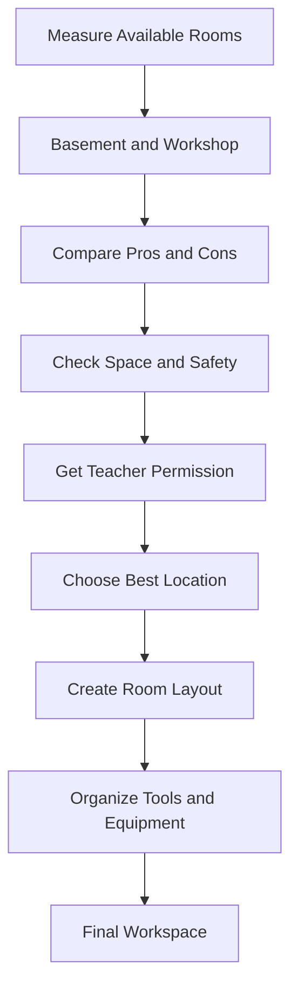

# FlowChart

# Important Things About Our Plastic Recycling Project

- In 2018, the United States produced about 35.7 million tons of plastic, but only about 3 million tons were recycled.
- Recycling plastic saves energy and reduces waste.
- Plastic must be separated by resin code because different plastics melt at different temperatures.
- Our best choices are #2 HDPE and #5 PP, but they should not be mixed.
- All plastic must be cleaned, dried, and have food or labels removed.
- Our recycling process is:
  1. Collect the plastic
  2. Identify and sort it
  3. Clean and dry it
  4. Shred it into small pieces
  5. Melt the plastic
  6. Form it into the final product
- The main machines needed are a plastic shredder and a machine that melts and forms the plastic.
- Project teams include the research, collection, shredder, processing, design, and building teams.
- Important challenges include contamination, sorting different plastics, safety, and the cost of equipment.

# Tasks, Teams, and Dependencies

| Task | Team | Depends On |
|---|---|---|
| Research plastic types and choose which plastic to recycle | Research Team | Design brief |
| Plan how the plastic will be collected and sorted | Collection Team | Plastic research |
| Generate shredder ideas | Shredder Team | Design brief |
| Choose the best shredder design | Shredder Team | Shredder ideas |
| Choose how to process the plastic | Processing Team | Plastic research |
| Create the CAD design | Design Team | Design brief |
| Gather materials and machine parts | Build Team | CAD design |
| Build the machine | Build Team | Materials and machine parts |
| Test the machine | Testing Team | Completed machine |
| Improve the final design | Design and Build Teams | Testing results |

# Plastic Shredder

## What It Does

The plastic shredder breaks plastic into small pieces. This make the plastic easier to melt and turn into something new.

## Notes

- Clean and dry the plastic first.
- Remove food, labels, and metal.
- Sort plastic by the resin number.
- Do not mix #2 and #5 plastic.
- Stop the shredder if it sounds weird.
- A teacher must watch us when we use it.

## Safety

- Wear safety glasses and closed toe shoes.
- Tie back long hair.
- Do not wear loose clothes or jewelry.
- Never put your hands inside the shredder.
- Keep the safety guard on.
- Turn it off and unplug it before removing stuck plastic.
- Know where the emergency stop button is.
- Keep people away while the shredder is running.

# Collection, Sorting, and Storage
## Plastic Collection
### What It Does
The collection process gets usable plastic from around the school and brings it to our team so it can be sorted, cleaned, stored, and later shredded.

Our main collection areas are:
- The lunchroom
- Plastic saved by teachers
- We are not collecting plastic from homes or businesses.

# Teacher Collection
We will ask teachers to save plastic from school instead of throwing it away.

Teachers can keep a small labeled container in their classroom.

# PLASTIC COLLECTION
## Put In:
- Empty plastic bottles
- Empty plastic cups

## Do Not Put In:
- Food
- Liquid
- Paper
- Metal
- Glass
- Regular trash

# Mechanical Team — Project Notes

## Project Overview

Our team is responsible for planning the mechanical workspace for our engineering project.

We are comparing the basement and workshop to find the best location for our tools, equipment, and work area.

Our goal is to find a space that is safe, organized, and easy to work in.

---

# Flowchart

---

# 1. Basement

## Pros

- More potential space for equipment and storage.
- Could provide our team with its own workspace.
- Less interruption from other classes.
- Ventilation and electrical outlets were noted.
- Could allow us to organize equipment in one area.

## Cons

- Located across the school from our classroom.
- A lot of trash and junk need to be removed.
- Moving heavy equipment downstairs could be difficult.
- Need permission before cleaning or using the basement.
- Takes more time to set up.
- Stairs and narrow hallways could make transportation difficult.
- The usable space may be smaller than it looks because of clutter.

## Problems to Solve

1. Find out who can approve cleaning the basement.
2. Figure out what equipment needs to be moved.
3. Measure the hallway, stairs, and doorways.
4. Decide what materials need to stay or be removed.
5. Make sure the area meets safety requirements.
6. Create a layout for tools and equipment.

---

# 2. Workshop

## Pros

- Located next to our classroom.
- Easy access to tools and equipment.
- Saves time walking between rooms.
- Easier for the teacher to supervise.
- Already used for mechanical work.
- Less preparation needed before starting.

## Cons

- Must share the workshop with another class.
- Limited space for equipment and storage.
- Other classes could interrupt our work.
- Cannot always leave tools and materials out.
- May need to move equipment between work periods.
- Need to coordinate with other classes.

## Problems to Solve

1. Find out how much space we can use.
2. Ask which areas are available for our team.
3. Figure out where our tools can be stored.
4. Make sure we do not interrupt other classes.
5. Create a workspace layout that keeps walkways clear.

---

# 3. Basement vs. Workshop Comparison

| Category | Basement | Workshop |
|---|---|---|
| Location | Across the school | Next to classroom |
| Space | More potential space | Shared space |
| Cleaning | Lots of trash and junk | Already a workspace |
| Tools | Must transport equipment | Tools nearby |
| Storage | More potential storage | Limited storage |
| Accessibility | Stairs may be difficult | Easier access |
| Supervision | Needs supervision plan | Teacher nearby |
| Setup Time | Longer | Shorter |
| Permission | Need approval | Need shared-use approval |
| Main Problem | Clutter and transportation | Sharing with another class |

---

# 4. Our Recommendation

For now, the workshop seems like the better choice.

Reasons:
- It is closer to our classroom.
- Tools and equipment are easier to access.
- The space is already used for mechanical work.
- It requires less cleaning and setup.

However, the basement could become a better option if we receive permission, remove the junk, and make sure the area is safe.

We have not made our final decision yet.

---

# 5. Current Progress

- X Started measuring the basement.
- X Created a drawing of the basement.
- X Identified electrical outlets.
- X  Noted ventilation in the basement.
- X Found problems with basement clutter.
- X Compared the basement and workshop.
-   Finish measuring all available spaces.
-   Get permission to use the basement.
-   Choose the final location.
-   Create the final workspace layout.

---

# 6. Mechanical Cart Idea

Our team also discussed using a Home Depot-style cart to organize mechanical tools and equipment.

## Why It Could Work

- Easy to move tools.
- Helps keep equipment organized.
- Can hold different supplies.
- Could save space.
- Makes tools easier to access.

## Why It Might Not Work

- Heavy equipment could make the cart unstable.
- Tools could fall off.
- The cart could move while someone is working.
- It might not fit through narrow doors.
- A regular cart may not safely support powered machinery.

## Possible Improvement

We could design a mobile tool workstation with:

- Locking wheels.
- Strong frame.
- Tool storage.
- Bottom shelf for heavy supplies.
- Labeled containers.

Powered machines would require separately approved supports.

---

# 7. Safety Requirements

Before choosing a workspace, we need to check:

- Emergency exits are not blocked.
- Doors and hallways are clear.
- Electrical outlets are safe and accessible.
- Equipment has enough space around it.
- Heavy materials can be moved safely.
- The area has teacher approval.
- Appropriate ventilation is available for the planned activities.

## Safety Rules

1. Do not move heavy machines without adult supervision.
2. Do not block exits or hallways.
3. Do not use damaged electrical equipment.
4. Do not operate machinery without approval and training.
5. Keep tools organized.
6. Report unsafe conditions to the teacher.
7. Do not remove unknown basement materials without permission.

---

# 8. Next Steps

## Step 1 — Finish Measurements

Measure:
- Workshop dimensions.
- Basement usable space.
- Doorway widths.
- Hallway widths.
- Stairway dimensions.
- Ceiling heights.
- Existing storage and equipment.

## Step 2 — Get Permission

Ask the teacher:
- Can we use the basement?
- Can we clean and organize it?
- Can we move equipment there?
- Which workshop areas can we use?
- What safety requirements must we follow?

## Step 3 — Compare All Three Rooms

Compare:
- Available space.
- Safety.
- Equipment access.
- Storage.
- Distance from classroom.
- Setup work required.

## Step 4 — Create a Layout

Draw:
- Tool storage locations.
- Equipment locations.
- Worktables.
- Walking paths.
- Doorways and exits.

## Step 5 — Final Decision

Discuss our findings with the team and teacher.

Choose the location that is safest and most useful.

---

# Final Goal

Our goal is to create a safe and organized mechanical workspace.

The location should have enough room for tools, equipment, storage, and students.

We will finish measuring, compare the available rooms, get teacher approval, and create a final layout before setting up the workspace.
